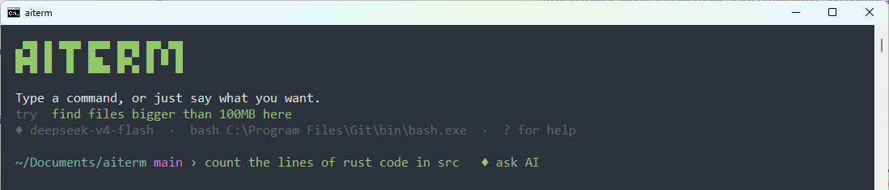
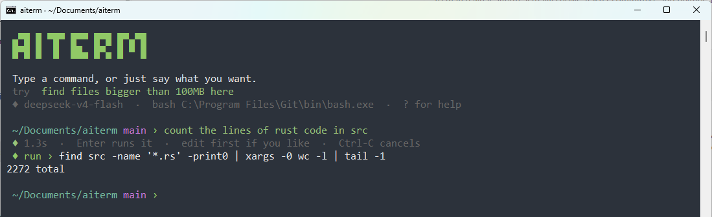
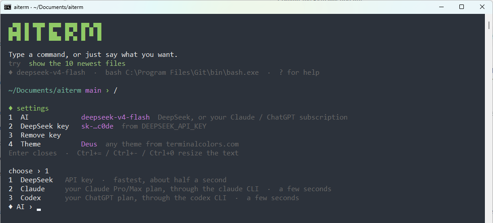
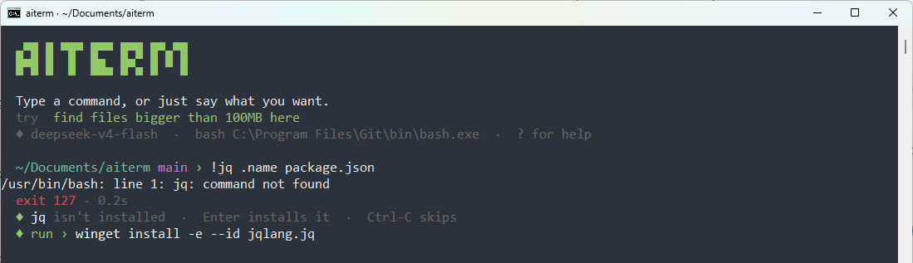

# aiterm

A small, fast bash front-end written in Rust. Type a command and it runs in bash. Type plain English and DeepSeek (or Claude or Codex, on your own subscription) turns it into a command, which you can edit before pressing Enter to run it.

While you type, plain English turns green and a hint shows that Enter will ask the AI:



The AI's command lands on an editable line. Press Enter to run it:



## Download

Every push to `main` is built by GitHub Actions and published as the [latest release](https://github.com/FlorinCristu/aiterm/releases/tag/latest):

- **Windows:** download `aiterm-setup-windows-x64.exe` and double-click it. See [Install on Windows](#install-on-windows-start-menu--path-no-admin).
- **Linux / macOS (Apple silicon):** download the `.tar.gz`, extract it and put `aiterm` on your PATH.

The release also carries `busybox-w32-….tgz`, the source of the `busybox.exe` bundled for Windows.

## Setup

```bash
setx DEEPSEEK_API_KEY sk-...     # or add the key from the / menu, or put it in ~/.aiterm_key
cargo build --release
```

You don't need a key to start: aiterm runs plain commands without one. The first time you ask the AI something, it lets you pick DeepSeek, Claude or Codex.

| Env var | Default | Purpose |
|---|---|---|
| `DEEPSEEK_API_KEY` | – | API key (or the file `~/.aiterm_key`) |
| `DEEPSEEK_MODEL` | `deepseek-v4-flash` | Model ID |
| `DEEPSEEK_BASE_URL` | `https://api.deepseek.com` | Any OpenAI-compatible endpoint |
| `DEEPSEEK_THINKING` | off | Set to `1` to allow reasoning (slower) |
| `AITERM_BACKEND` | saved choice, else `deepseek` | `deepseek`, `claude` or `codex` |
| `AITERM_CLAUDE_MODEL` | `haiku` | Model for the Claude backend |
| `AITERM_CODEX_MODEL` | Codex's default | Model for the Codex backend |
| `AITERM_BASH` | Windows: Git Bash, else the bundled `busybox.exe`. Elsewhere: `bash` | Which bash to run. A file named `busybox*.exe` is run as `busybox bash -c` (handy to try the built-in shell on a machine that has Git Bash) |

### Works without Git Bash

On Windows aiterm prefers Git Bash, and when Git for Windows isn't installed it uses the [busybox-w32](https://frippery.org/busybox/) `busybox.exe` that ships next to `aiterm.exe` (the banner then says `busybox bash (built-in)`). Its shell is ash in bash-compatible mode and its ~180 applets (`ls`, `grep`, `find`, `sed`, `awk`, `tar`, `wget`, …) count as commands for the English-or-command check and for Tab. The AI is told it is writing for busybox. What's different from Git Bash:

- Fewer GNU extras: no `grep -P`, `find -printf`, `date -d yesterday`, `ls --time-style`; no bash arrays, `{a,b}` brace expansion, `shopt` or `${x^^}`.
- Paths are `C:/Users/...`; `/c/Users` doesn't work, and `/x` means `x` at the root of the current drive.
- busybox's applets win over Windows programs of the same name (`find`, `sort`, `tar`, `make`, `ping`, …). `git` and Git's other tools aren't there; `curl` is Windows' own `curl.exe`.

Install Git for Windows (`winget install -e --id Git.Git`) for the full set; aiterm switches to it on its next start. If neither is found, aiterm says so at startup instead of failing on every command. It never uses `C:\Windows\System32\bash.exe`, which starts WSL.

Building from source, `powershell -ExecutionPolicy Bypass -File packaging\fetch-busybox.ps1 -Dest target\debug` puts the pinned, checksum-verified busybox next to the dev build. busybox is GPL-2.0; see `packaging/THIRD-PARTY.md`.

### Use your Claude or ChatGPT subscription instead

Type `/`, choose **1 AI**, then pick **Claude** or **Codex**. aiterm runs the official CLI headless (`claude -p` or `codex exec`), so your requests use the plan you signed in to through that CLI's browser login. aiterm never handles your password or token. The menu can start the sign-in for you (`claude auth login` / `codex login`), and **5 Sign in** in the menu does it again later. The choice is saved in `~/.aiterm_backend`.

You need the CLI on PATH (`npm install -g @anthropic-ai/claude-code` or `npm install -g @openai/codex`). This is slower than DeepSeek: each request starts the CLI, so a reply takes a few seconds (about 5s with Claude Haiku) rather than half a second.

## Install on Windows (Start Menu + PATH, no admin)

Double-click `aiterm-setup-windows-x64.exe`. It installs for your user only, in `%LOCALAPPDATA%\Programs\aiterm`, and asks whether to open aiterm when it's done. aiterm then appears in Windows search and in Settings → Apps, where you can uninstall it. `aiterm` is also added to your PATH.

The installer isn't signed, so Windows SmartScreen may say it "protected your PC". Click **More info**, then **Run anyway**. If you'd rather not run an unsigned exe, download `aiterm-setup-windows-x64.zip` instead, unzip it and double-click `install.cmd`, which runs the same `install.ps1` you can read first. That one also asks for a DeepSeek key if you have none (Enter skips); the exe doesn't, and aiterm asks the first time you use the AI.

To install or update, close aiterm first: the installer stops with a message if aiterm is running. Uninstalling closes it for you. Your settings (`~/.aiterm_*`, `DEEPSEEK_API_KEY`) are kept either way.

The Start Menu shortcut opens [aiterm's own window](#aiterms-own-window-windows). `install.ps1 -Console` points it at aiterm in a classic console window instead; for Windows Terminal, just run `aiterm` there. `install.ps1 -WhatIf` and `uninstall.ps1 -WhatIf` print what they would change and change nothing. `aiterm-setup.exe /quiet` installs without any messages (the exit code is 0 when it worked), and `aiterm-setup.exe /extract <folder>` only unpacks the files.

To build the installer yourself:

```bash
powershell -ExecutionPolicy Bypass -File packaging\build.ps1
```

This builds `aiterm.exe` and `aiterm-app.exe`, fetches the pinned busybox, stages everything in `dist\aiterm-setup\`, and makes `dist\aiterm-setup.exe` (those files embedded in one exe, see `setup/`) and `dist\aiterm-setup.zip`.

`dev/test-server.js` is a tiny HTTP server on port 3300. It's handy for testing requests like "kill whatever is on port 3300".

## aiterm's own window (Windows)

`aiterm-app.exe`, which the Start Menu shortcut opens, is a window of its own with tabs. Each tab runs `aiterm.exe` in a pseudo-terminal, drawn by xterm.js; the taskbar shows aiterm's icon and the window takes your theme's colours.

- Ctrl+Shift+T opens a tab in the current tab's folder, Ctrl+Shift+W closes it, Ctrl+Shift+N opens a new window. `/tab` and `/window` do the same. Ctrl+Tab and Ctrl+Shift+Tab switch tabs; `+` adds one, and a middle click or `×` closes one.
- Ctrl+C copies when text is selected (otherwise it stops the running command as usual), Ctrl+Shift+C copies, Ctrl+V pastes. Right-click copies a selection, or pastes when nothing is selected.
- Ctrl+= / Ctrl+- / Ctrl+0 make the text bigger, smaller, or reset it.
- Drag files or folders onto the window to type their paths, quoted.

It needs the Microsoft Edge WebView2 Runtime, which Windows 11 has built in; if it's missing, aiterm-app says so. `aiterm` in Windows Terminal or any other terminal works as before.

## Keys and commands

- `#text`: always ask the AI. `!text`: always run in bash.
- While you type, the text turns green and a `♦ ask AI` hint appears when Enter will go to the AI instead of bash. A known command name is shown in bold.
- On the `run ›` line, type `#only .js files` instead of pressing Enter and the AI changes its command to match.
- When the AI's command can destroy something (`rm -rf`, `git reset --hard`, a force push, `curl | sh`, …), a red line says what it does before you press Enter.
- `?tar -xzf x.tgz` explains a command in plain words without running it. `??` explains the last command.
- `z proj` jumps to the folder you visit most whose path matches; `z` alone lists your top folders. Folders are remembered as you `cd` into them.
- A command that took 10 seconds or more flashes the taskbar when it finishes while you're in another window (in aiterm's window and the classic console; elsewhere it rings the terminal bell).
- `/` opens settings. `?` shows a short help.
- Tab completes command names in the first word, branches and tags after `git checkout`/`switch`/`merge`/…, and file names. As you type, the rest of your newest matching past command shows in grey; Right, End or Ctrl-E accepts it. Up and Down browse history, saved in `~/.aiterm_history`.
- Ctrl-C stops the running command or cancels an AI request. Ctrl-D, `exit` or `logout` quits.
- `/tab` opens a new tab in the current folder (in aiterm's window and in Windows Terminal; elsewhere a new window), `/window` a new window. In the classic console Ctrl+Shift+T / Ctrl+Shift+N do the same and Ctrl+Shift+W closes the window.
- `clear` or Ctrl-L clears the screen.
- Ctrl+= / Ctrl+- / Ctrl+0 make the text bigger, smaller, or reset it (see below).

## Settings (`/`)

| # | Item | What it does |
|---|---|---|
| 1 | AI | Pick DeepSeek, Claude or Codex |
| 2 | DeepSeek key | Paste a key. It's hidden as you type, checked against DeepSeek, and saved in `~/.aiterm_key` |
| 3 | Remove key | Deletes `~/.aiterm_key` |
| 4 | Theme | Load a colour theme (see below) |
| 5 | Sign in | Shown when Claude or Codex is chosen. Runs that CLI's browser sign-in |



`DEEPSEEK_API_KEY` and `AITERM_BACKEND` in the environment win over the saved files. The menu tells you when one of them is set.

## What the AI sees

The AI gets your request plus your OS, the current folder, up to 60 file names from it, and the previous command with its exit code. That lets "undo that" or "same but for .js files" work. Its reply is reduced to a single command line before it reaches the editable `run ›` prompt. Nothing runs until you press Enter.

## Prompt and status

- The prompt shows the current folder and, inside a git repo, the branch, read straight from `.git`, so drawing it costs nothing. The `›` turns red after a failed command.
- After a command: nothing for a quick success, `done in 3.2s` for slow ones, `exit 1 · 0.3s` for failures, `interrupted` after Ctrl-C.
- The window title follows the current folder.

## Missing commands

When bash says "command not found", aiterm puts the install command on the editable line (`winget` on Windows, `brew` on macOS, and `apt`/`dnf`/`pacman`/`zypper`/`apk` on Linux). Press Enter to install, or Ctrl-C to skip. When it doesn't know the package, it offers a package search instead. After a `winget`, `scoop` or `choco` install, aiterm reloads PATH, so the new command works right away without a restart.



## Themes

Under `/` → **4 Theme**, paste a [terminalcolors.com](https://terminalcolors.com) theme link, or the path of a downloaded theme file in Ghostty, Alacritty, Warp or iTerm2 format. The theme colours the whole window, including bash output, and is saved in `~/.aiterm_theme`. Type `deus` to go back to the default. If you started aiterm from another terminal, it puts that terminal's colours back when you quit.

## Text zoom

aiterm's own window and Windows Terminal zoom with Ctrl+= / Ctrl+- / Ctrl+0 by themselves. The classic console doesn't, so aiterm adds those keys there, sizes 10–48 px. The keys only act while aiterm's console is in front. aiterm's window and the classic console both remember the size in `~/.aiterm_font`.

## How it decides (`src/detect.rs`)

This follows the approach of Warp's `is_likely_shell_command` heuristic:

1. If the line contains shell operators (`| && ; > $( \``), a path, or a `VAR=` assignment, it goes to bash.
2. If the first word is not a known command (bash built-ins plus everything on PATH, including Git's `usr/bin`, or busybox's applets with the built-in shell), it goes to the AI.
3. If the first word is a known command, aiterm counts English filler words (`the`, `all`, `my`, `than`, …). If enough of them appear, it goes to the AI. Words inside quotes are ignored, so `git commit -m "fix the bug"` stays a command.

## Speed

- The release binary is about 2 MB and starts instantly.
- The TLS connection to DeepSeek opens in the background at startup, so the first request skips the handshake.
- Thinking is off, temperature is 0, and the reply is streamed and capped at 300 tokens.
- With Claude or Codex, aiterm turns off the CLI features a one-line answer doesn't need (tools, MCP servers, settings, slash commands, session saving) to keep startup short.
- Each command runs as a direct `bash -c` (`busybox bash -c` with the built-in shell) with no login-shell startup. `cd` (including `cd -` and `~`) and simple `export`s are handled in-process, so their effect persists.

## Files

| File | Holds |
|---|---|
| `~/.aiterm_key` | DeepSeek key |
| `~/.aiterm_backend` | Chosen AI (`deepseek`, `claude` or `codex`) |
| `~/.aiterm_history` | Command history |
| `~/.aiterm_theme` | Active theme, in Ghostty format |
| `~/.aiterm_font` | Text size (aiterm's window and the classic console) |
| `~/.aiterm_dirs` | Folders `z` remembers |

## License

MIT. See [LICENSE](LICENSE).
