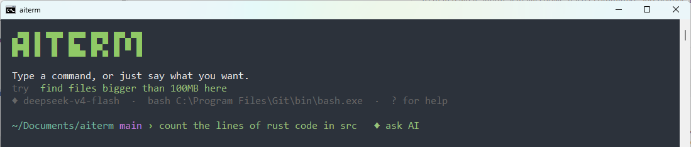
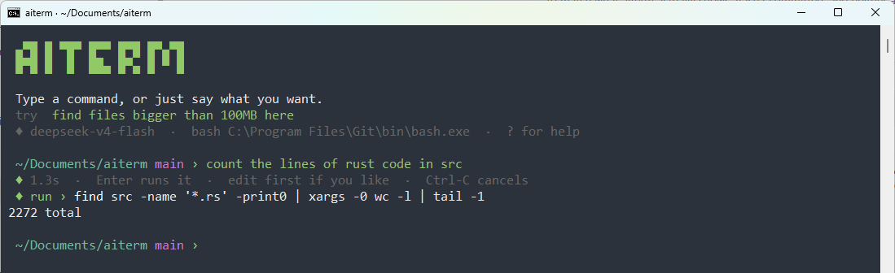
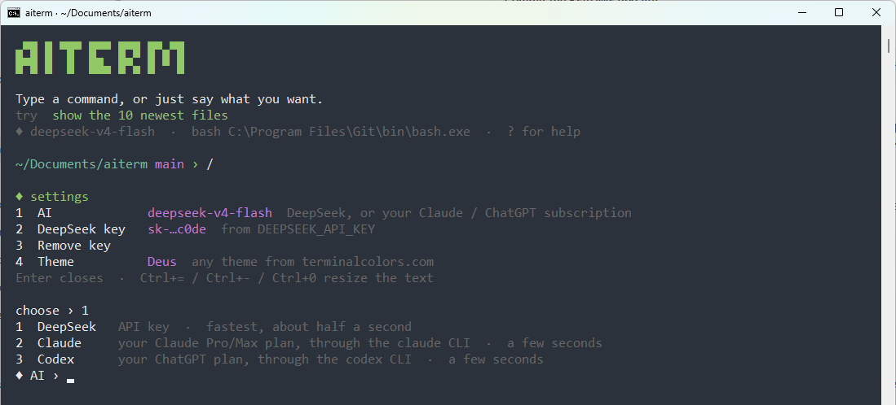
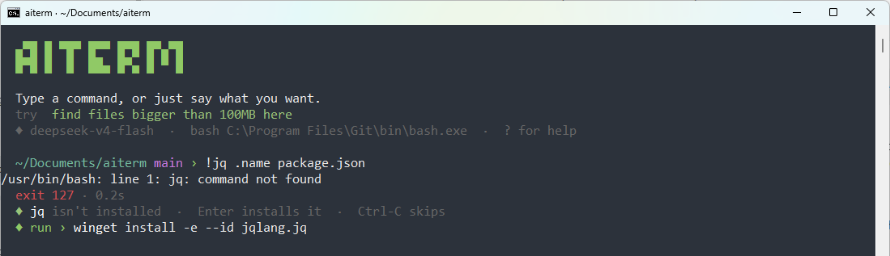

# aiterm

A small, fast bash front-end written in Rust. Type a command and it runs in bash. Type plain English and DeepSeek (or Claude or Codex, on your own subscription) turns it into a command, which you can edit before pressing Enter to run it.

While you type, plain English turns green and a hint shows that Enter will ask the AI:



The AI's command lands on an editable line. Press Enter to run it:



## Setup

```bash
setx DEEPSEEK_API_KEY sk-...     # or add the key from the / menu, or put it in ~/.aiterm_key
cargo build --release
```

You don't need a key to start: aiterm runs plain commands without one. The first time you ask the AI something, it lets you pick DeepSeek, Claude or Codex.

| Env var | Default | Purpose |
|---|---|---|
| `DEEPSEEK_API_KEY` | – | API key (or the file `~/.aiterm_key`) |
| `DEEPSEEK_MODEL` | `deepseek-v4-flash` | Model ID |
| `DEEPSEEK_BASE_URL` | `https://api.deepseek.com` | Any OpenAI-compatible endpoint |
| `DEEPSEEK_THINKING` | off | Set to `1` to allow reasoning (slower) |
| `AITERM_BACKEND` | saved choice, else `deepseek` | `deepseek`, `claude` or `codex` |
| `AITERM_CLAUDE_MODEL` | `haiku` | Model for the Claude backend |
| `AITERM_CODEX_MODEL` | Codex's default | Model for the Codex backend |
| `AITERM_BASH` | Git Bash on Windows, `bash` elsewhere | Which bash to run |

### Use your Claude or ChatGPT subscription instead

Type `/`, choose **1 AI**, then pick **Claude** or **Codex**. aiterm runs the official CLI headless (`claude -p` or `codex exec`), so your requests use the plan you signed in to through that CLI's browser login. aiterm never handles your password or token. The menu can start the sign-in for you (`claude auth login` / `codex login`), and **5 Sign in** in the menu does it again later. The choice is saved in `~/.aiterm_backend`.

You need the CLI on PATH (`npm install -g @anthropic-ai/claude-code` or `npm install -g @openai/codex`). This is slower than DeepSeek: each request starts the CLI, so a reply takes a few seconds (about 5s with Claude Haiku) rather than half a second.

## Install on Windows (Start Menu + PATH, no admin)

```bash
powershell -ExecutionPolicy Bypass -File packaging\build.ps1
```

This builds `dist\aiterm-setup\` and `dist\aiterm-setup.zip`. To install, run `install.cmd` from there. It asks for a DeepSeek key if you have none (Enter skips). aiterm then appears in Windows search and in Settings → Apps, and you can uninstall it from there. Run `install.ps1 -Quiet` to skip the key prompt.

The Start Menu shortcut opens aiterm in its own console window, so the taskbar shows the aiterm icon. To open it in Windows Terminal instead, install with `install.ps1 -UseWindowsTerminal`. Windows Terminal renders text more nicely, but the taskbar then shows the Terminal icon.

`dev/test-server.js` is a tiny HTTP server on port 3300. It's handy for testing requests like "kill whatever is on port 3300".

## Keys and commands

- `#text`: always ask the AI. `!text`: always run in bash.
- While you type, the text turns green and a `♦ ask AI` hint appears when Enter will go to the AI instead of bash. A known command name is shown in bold.
- `/` opens settings. `?` shows a short help.
- Tab completes file names. Up and Down browse history, saved in `~/.aiterm_history`.
- Ctrl-C stops the running command or cancels an AI request. Ctrl-D, `exit` or `logout` quits.
- Ctrl+= / Ctrl+- / Ctrl+0 make the text bigger, smaller, or reset it (see below).

## Settings (`/`)

| # | Item | What it does |
|---|---|---|
| 1 | AI | Pick DeepSeek, Claude or Codex |
| 2 | DeepSeek key | Paste a key. It's hidden as you type, checked against DeepSeek, and saved in `~/.aiterm_key` |
| 3 | Remove key | Deletes `~/.aiterm_key` |
| 4 | Theme | Load a colour theme (see below) |
| 5 | Sign in | Shown when Claude or Codex is chosen. Runs that CLI's browser sign-in |



`DEEPSEEK_API_KEY` and `AITERM_BACKEND` in the environment win over the saved files. The menu tells you when one of them is set.

## What the AI sees

The AI gets your request plus your OS, the current folder, up to 60 file names from it, and the previous command with its exit code. That lets "undo that" or "same but for .js files" work. Its reply is reduced to a single command line before it reaches the editable `run ›` prompt. Nothing runs until you press Enter.

## Prompt and status

- The prompt shows the current folder and, inside a git repo, the branch, read straight from `.git`, so drawing it costs nothing. The `›` turns red after a failed command.
- After a command: nothing for a quick success, `done in 3.2s` for slow ones, `exit 1 · 0.3s` for failures, `interrupted` after Ctrl-C.
- The window title follows the current folder.

## Missing commands

When bash says "command not found", aiterm puts the install command on the editable line (`winget` on Windows, `brew` on macOS, and `apt`/`dnf`/`pacman`/`zypper`/`apk` on Linux). Press Enter to install, or Ctrl-C to skip. When it doesn't know the package, it offers a package search instead. After a `winget`, `scoop` or `choco` install, aiterm reloads PATH, so the new command works right away without a restart.



## Themes

Under `/` → **4 Theme**, paste a [terminalcolors.com](https://terminalcolors.com) theme link, or the path of a downloaded theme file in Ghostty, Alacritty, Warp or iTerm2 format. The theme colours the whole window, including bash output, and is saved in `~/.aiterm_theme`. Type `deus` to go back to the default. If you started aiterm from another terminal, it puts that terminal's colours back when you quit.

## Text zoom

Windows Terminal zooms with Ctrl+= / Ctrl+- / Ctrl+0 by itself. The classic console doesn't, so aiterm adds those keys there, sizes 10–48 px, and remembers the size in `~/.aiterm_font`. The keys only act while aiterm's window is in front.

## How it decides (`src/detect.rs`)

This follows the approach of Warp's `is_likely_shell_command` heuristic:

1. If the line contains shell operators (`| && ; > $( \``), a path, or a `VAR=` assignment, it goes to bash.
2. If the first word is not a known command (bash built-ins plus everything on PATH, including Git's `usr/bin`), it goes to the AI.
3. If the first word is a known command, aiterm counts English filler words (`the`, `all`, `my`, `than`, …). If enough of them appear, it goes to the AI. Words inside quotes are ignored, so `git commit -m "fix the bug"` stays a command.

## Speed

- The release binary is about 2 MB and starts instantly.
- The TLS connection to DeepSeek opens in the background at startup, so the first request skips the handshake.
- Thinking is off, temperature is 0, and the reply is streamed and capped at 300 tokens.
- With Claude or Codex, aiterm turns off the CLI features a one-line answer doesn't need (tools, MCP servers, settings, slash commands, session saving) to keep startup short.
- Each command runs as a direct `bash -c` with no login-shell startup. `cd` (including `cd -` and `~`) and simple `export`s are handled in-process, so their effect persists.

## Files

| File | Holds |
|---|---|
| `~/.aiterm_key` | DeepSeek key |
| `~/.aiterm_backend` | Chosen AI (`deepseek`, `claude` or `codex`) |
| `~/.aiterm_history` | Command history |
| `~/.aiterm_theme` | Active theme, in Ghostty format |
| `~/.aiterm_font` | Console text size |

## License

MIT. See [LICENSE](LICENSE).
